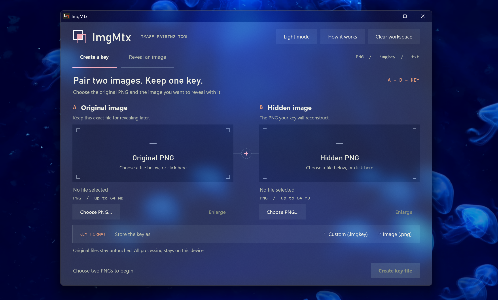

# ImgMtx


[](LICENSE)

ImgMtx connects two PNGs with a separate key. Choose an **original image** and a **hidden image**, then create a key as another PNG or a custom file. Later, open the unchanged original and its key to reconstruct the hidden image exactly.

Neither input is modified. Everything happens locally.

```text
Create a key    Original PNG + hidden PNG  →  key file
Reveal image   Original PNG + key file    →  hidden PNG
```


## Features

- **PNG image keys** — store the key in the pixels of a normal, viewable PNG.
- **Custom keys** — save compact `.imgkey` files or Base64 `.txt` files.
- **Exact recovery** — preserve the hidden PNG’s complete file contents, including metadata and transparency.
- **Flexible image pairs** — original and hidden images can have different dimensions.
- **Automatic format detection** — open any supported key format.
- **Light and dark modes** — switch themes without losing loaded files or results.
- **Image viewing** — paired previews, file information, enlarged views, and actual-size viewing.
- **File protection** — reject mismatched originals and damaged keys; never overwrite existing files.
- **Offline operation** — no accounts, uploads, telemetry, or runtime network requests.
- **Background processing** — keep the interface responsive during key creation and recovery.

## Installation

Windows is the tested desktop platform. You need **Python 3.11+**, **Tkinter**, and **Pillow 13+**.

The standard Windows Python installer includes Tkinter when its Tcl/Tk component is enabled.

```powershell
git clone https://github.com/Plutonium-fream/imgmtx.git
cd imgmtx
py -3 -m venv .venv
.\.venv\Scripts\python.exe -m pip install -r requirements.txt
.\.venv\Scripts\python.exe -m imgmtx
```

After setup, double-click `Start-ImgMtx.cmd` to launch.

## Usage

### Create a key

1. Open **Create a key**.
2. Choose the **Original image**.
3. Choose the **Hidden image**.
4. Select **Custom (.imgkey)** or **Image (.png)**.
5. Click **Create key file** and save to a new filename.

PNG keys look like coloured noise. Their pixels contain the transformation data. The custom save dialog also supports `.txt` keys.

### Reveal an image

1. Open **Reveal an image**.
2. Select the exact original PNG and its matching key.
3. Click **Reveal image**.
4. Use **Enlarge** or double-click a preview to inspect it.
5. Click **Save PNG** to export the recovered image.

The hidden source file is not needed for recovery. Keep only the original and its key to reveal again later.

Try the included `samples/original.png` and `samples/hidden.png`.

### Appearance

Use **Dark mode** or **Light mode** in the top bar. The theme also updates open viewers and help windows. Each new session starts in light mode.

### Keyboard shortcuts

| Shortcut | Action |
| --- | --- |
| `Ctrl+O` | Choose the original PNG |
| `Ctrl+Shift+O` | Choose the hidden PNG or key |
| `Ctrl+S` | Save a revealed image |
| `Enter` | Run the primary action when ready |
| `Esc` | Close an enlarged image viewer |

## File handling

- **Original PNG:** keep every file byte unchanged. Re-saving or modifying metadata invalidates its match. Renaming or moving it is fine.
- **PNG key:** preserve its RGB pixels and dimensions. Lossless PNG compression and metadata changes are fine. Resizing, editing, introducing transparency, or converting to JPEG breaks recovery.
- **Custom/text key:** keep its contents intact.
- Original and hidden PNGs are limited to **64 MiB** and **25 million pixels** each.
- Key files can be roughly as large as the hidden image. Text encoding adds approximately one third.
- Image keys must be static RGB or fully opaque RGBA PNGs.
- Existing files are never overwritten.

## Security model

ImgMtx is an image-mapping utility, not password-protected encryption.

Anyone with both the original and the key can reveal the hidden image. If the original is public, possession of the key is enough. Checksums detect accidental corruption; they do not protect against deliberate modification or authenticate a sender.

Keep your keys private. Clearing the workspace is not a secure memory erase.

## Project structure

```text
imgmtx/
├── imgmtx/
│   ├── __init__.py
│   ├── __main__.py        # Module entry point
│   ├── app.py             # Desktop interface and workflows
│   ├── core.py            # Key formats and image recovery
│   └── theme.py           # Light/dark palettes
├── assets/                # Application icon and branding
├── samples/               # Example image pair
├── tests/                 # Core, UI, theme, and layout tests
├── tools/
│   └── make_icon.py       # Icon generator
├── docs/
│   └── key-format.md      # Format specification
├── Start-ImgMtx.cmd       # Windows launcher
├── run_imgmtx.py          # Executable entry point
├── build.ps1             # Windows build script
├── requirements.txt
└── LICENSE
```

## Development

Run the tests:

```powershell
.\.venv\Scripts\python.exe -m unittest discover -s tests -v
```

Tests cover all key formats, exact recovery, damaged inputs, file preservation, theme changes, desktop workflows, and layout.

UI tests require an available desktop. The hardlink test skips when the environment cannot create hardlinks.

### Build a standalone Windows app

```powershell
.\.venv\Scripts\python.exe -m pip install pyinstaller
.\build.ps1 -Python .\.venv\Scripts\python.exe
```

The build creates `dist/ImgMtx.exe`, including Python, Tkinter, and Pillow. The executable runs without a separate Python installation.

Generated executables and build dependencies are excluded from source control.

## License

[MIT](LICENSE) © 2026 Plutonium-fream.
